# Olist SQL Analysis — Result Screenshots

MySQL query outputs for ten business questions covering customer payments, monthly growth, category performance and delivery performance. Q7 has two screenshots: the category intersection and its overlap percentage.

## Scope and metric definitions

- **Dataset:** [Olist Brazilian E-Commerce Public Dataset](https://www.kaggle.com/datasets/olistbr/brazilian-ecommerce).
- **Purchase window:** January 2017–August 2018, inclusive (`2017-01-01 <= order_purchase_timestamp < 2018-09-01`). All 20 months contain orders and payments.
- **Population:** All order statuses are retained unless a question explicitly filters them. Related items and payments follow the selected order IDs. A delivery can occur after August 2018 if its order was purchased within the window.
- **Currency:** Brazilian reais (BRL).
- **Customer payments (Q1, Q2 and Q4):** Recorded `payment_value`, including shipping. These are gross customer payments, not Olist's recognized company revenue or refund-adjusted net sales.
- **Category sales (Q5, Q7 and Q8):** Sum of item `price`, excluding shipping. The screenshot columns named `revenue` refer to this merchandise sales value.
- **Category order volume (Q6–Q8):** Distinct orders within each category. One order can count in more than one category.
- **NULL categories:** Products without a recorded category remain grouped under SQL `NULL`.

The outputs were reproduced in native MySQL 8.0.46 and reconciled independently against the source CSVs. Q5 and Q6 are partial views of longer, 74-group result tables; their screenshots do not display every row.

## Q1 — Monthly gross customer payments

Recorded payments by purchase month. November 2017 has the highest value at **BRL 1,194,882.80**; January 2017 has the lowest at **BRL 138,488.04**.

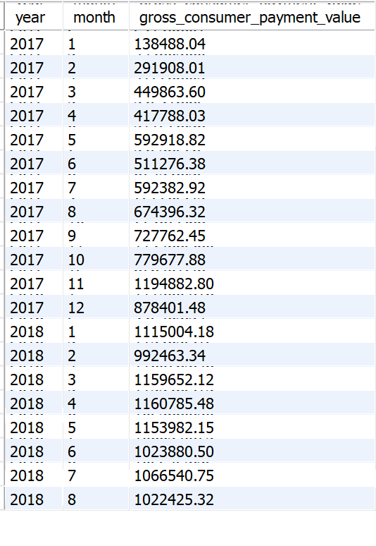

## Q2 — Month-over-month payment growth

Growth is `(current month payments - previous month payments) / previous month payments × 100`, rounded to two decimal places. January 2017 is `NULL` because no previous month is included in the analysis window. Missing calendar months, if present, remain `NULL` rather than being treated as zero.

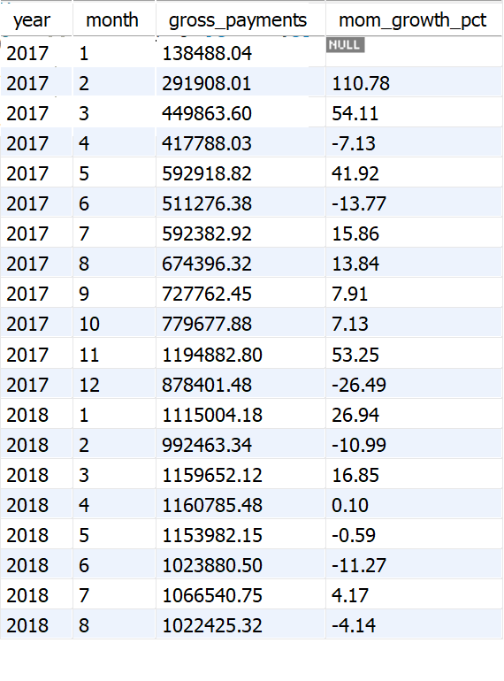

## Q3 — Total orders and merchandise AOV

**99,092 total orders** and **BRL 137.68 average merchandise order value**, excluding shipping.

The total order count includes all selected orders. AOV averages the item-price total for each of the **98,353 orders with item records**. The **739 orders without item records** have a `NULL` item total and are excluded from the average.

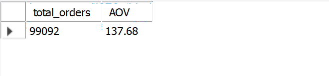

## Q4 — Highest and lowest monthly payments and growth

- Highest payments: **November 2017 — BRL 1,194,882.80**.
- Lowest payments: **January 2017 — BRL 138,488.04**.
- Highest MoM growth: **February 2017 — +110.78%**.
- Lowest MoM growth: **December 2017 — −26.49%**.

The `metric_value` column contains BRL for payment rows and percentages for growth rows, as identified by `type`.

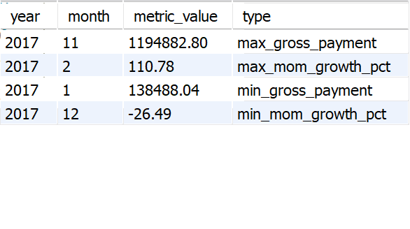

## Q5 — Categories ranked by merchandise sales

**Partial result view.** `beleza_saude` leads with **BRL 1,253,993.86** in item-price sales. The complete query returns 74 groups, including the unclassified `NULL` group; the screenshot is cropped near the `eletronicos` row.

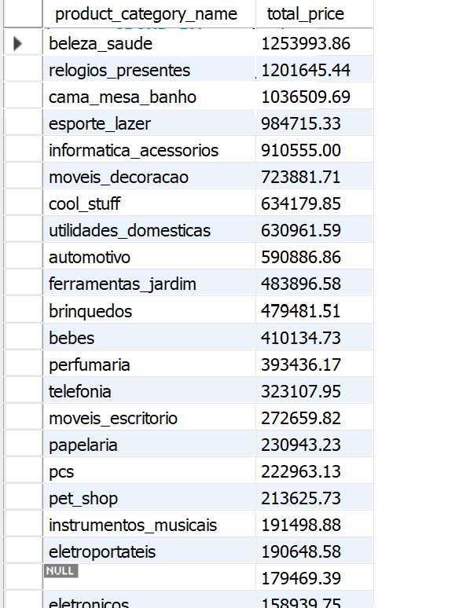

## Q6 — Categories ranked by distinct order count

**Partial result view.** `cama_mesa_banho` leads with **9,412 distinct orders**. The complete query returns 74 groups; the screenshot is cropped near `malas_acessorios`. The truncated label `fashion_bolsas_e_acess...` is `fashion_bolsas_e_acessorios`.

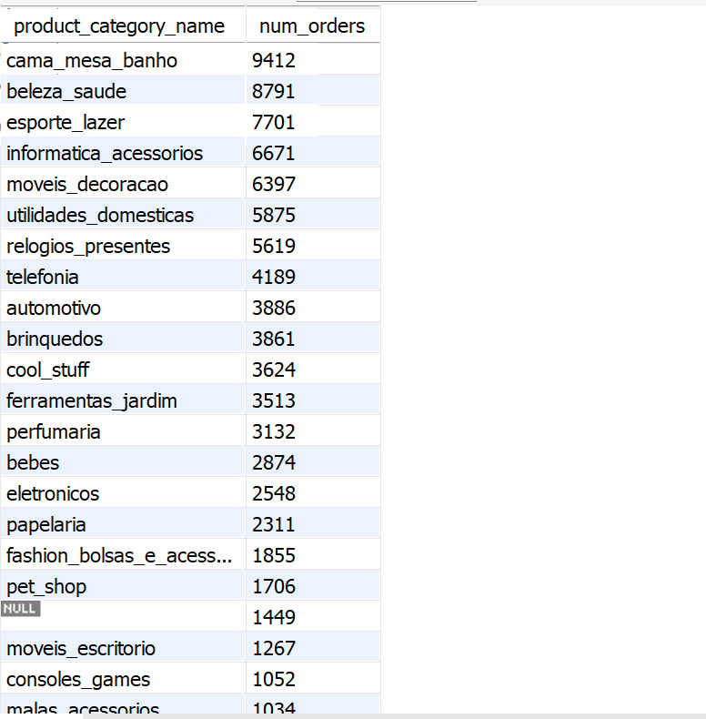

## Q7 — Overlap between leading sales and order-volume categories

The first `NTILE(10)` bucket contains **8 groups** in each ranking. **7 categories are common** to both, giving **7 ÷ 8 × 100 = 87.5% overlap**.

There are 74 groups in the ranking, including `NULL`. Eight groups represent approximately 10.81% of the groups, so “top 10%” describes the first decile bucket rather than an exact fraction. The percentage measures category-list overlap, not a share of sales or orders. The separate percentage query uses the verified, fixed counts `7` and `8` for this dataset.

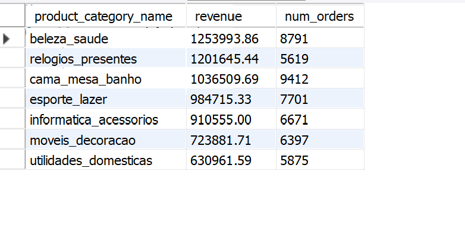

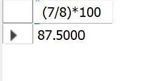

## Q8 — Categories with both high sales and high order volume

The first `NTILE(5)` bucket contains **15 groups** in each ranking, approximately 20.27% of the 74 groups. Their intersection contains **14 categories**, shown with merchandise sales, distinct order counts and both ranks.

This is a management shortlist based on observed sales and order volume. Profitability and future demand require additional analysis.

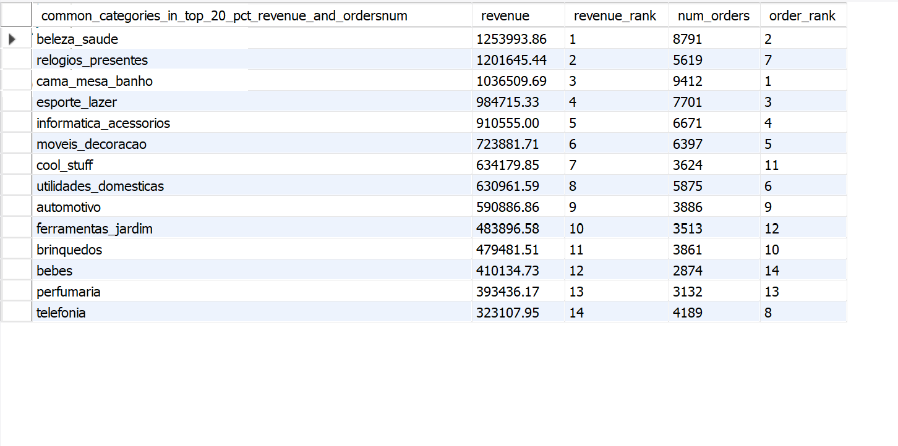

## Q9 — Average calendar-day delivery time

**12.4770 calendar days**, or **12.48 days** rounded to two decimal places.

The calculation is `AVG(DATEDIFF(order_delivered_customer_date, order_purchase_timestamp))` over orders with available dates, irrespective of order status. It uses **96,204 date pairs**, including one order marked canceled that has a recorded customer-delivery date. `DATEDIFF` measures calendar-date differences rather than fractional elapsed days.

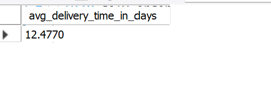

## Q10 — Confirmed late-delivery rate

**6,531 confirmed late orders ÷ 96,211 delivered orders × 100 = 6.79%**, rounded to two decimal places.

An order is late when its actual customer-delivery calendar date is after its estimated delivery date. Eight orders marked delivered have no actual delivery date; they remain in the denominator but cannot be classified as late or on time. The result is therefore the **minimum confirmed late-delivery rate among all orders marked delivered**.

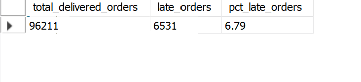
